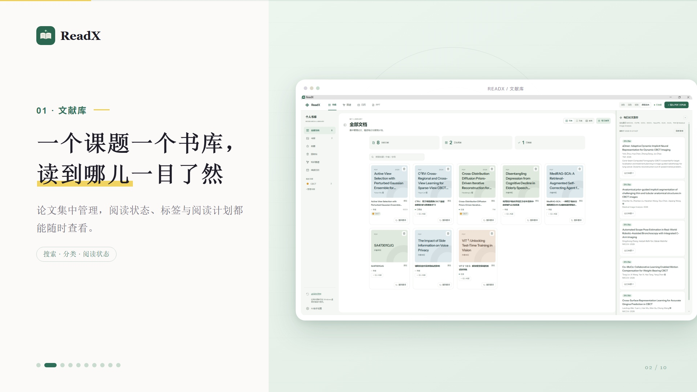

<p align="center">
  
</p>

<h1 align="center">ReadX</h1>

<p align="center"><strong>把论文读懂，把研究过程连起来。</strong><br>本地优先的论文阅读、翻译与研究工作区 · Windows / macOS</p>

<p align="center">
  <a href="https://github.com/Leechion/ReadX/releases/latest"></a>
  <a href="https://github.com/Leechion/ReadX/actions/workflows/release-windows.yml"></a>
  <a href="https://github.com/Leechion/ReadX/actions/workflows/build-macos.yml"></a>
</p>

<p align="center"><a href="#中文">简体中文</a> · <a href="#english">English</a> · <a href="windows/README.md">使用与开发文档</a></p>

## ReadX 宣传视频

<p align="center">
  <a href="docs/media/ReadX.mp4"></a>
</p>

<p align="center"><a href="docs/media/ReadX.mp4">▶ 打开或下载完整 MP4</a></p>

## 中文

ReadX 是一个面向科研阅读的桌面工作区。导入论文后，可以在同一处查看原文与译文、标注重点、向 AI 助教提问，并把阅读结果整理成结构化分析或演示文稿。论文文件与阅读资料优先保存在本机。

### 界面预览

<table>
  <tr>
    <td width="50%"><p align="center">文献库</p></td>
    <td width="50%"><p align="center">导入论文</p></td>
  </tr>
  <tr>
    <td><p align="center">处理进度</p></td>
    <td><p align="center">双语阅读</p></td>
  </tr>
  <tr>
    <td><p align="center">高亮与批注</p></td>
    <td><p align="center">AI 助教</p></td>
  </tr>
  <tr>
    <td><p align="center">精读五重奏</p></td>
    <td><p align="center">PPT 工作区</p></td>
  </tr>
  <tr>
    <td><p align="center">AI 助手设置</p></td>
    <td><p align="center">ReadX</p></td>
  </tr>
</table>

### 功能

- **论文书库**：导入 PDF 与 EPUB，按阅读状态、标签和书架整理论文，并恢复阅读位置。
- **逐页翻译与双语阅读**：处理后的译文可逐页查看；原文、译文并排显示，保留论文页面结构。
- **段落、图表与公式**：识别目录和页面内容；选中段落或公式可高亮、翻译整段或交给 AI 助教解释。
- **论文上下文问答**：助教围绕当前论文回答问题，支持将相关页面内容和图片纳入理解。
- **精读五重奏**：分别分析实验动机、方法公式、实验配置、结果分析与代码复现；各部分独立生成和保存。
- **论文演示稿**：从书库选择论文，在独立 PPT 工作区生成演示稿并实时预览；支持自定义模板和内置主题。
- **本地优先**：论文、阅读位置、批注和精读资料保存在本机。连接云端模型时，提交给模型的内容会发送到所选服务。

### 下载与开始使用

从[最新 Release](https://github.com/Leechion/ReadX/releases/latest)下载 Windows 或 macOS 安装包。启动后，在 **AI 助手设置**中选择模型服务并配置连接；Codex Desktop 用户可先登录 Codex，再从 ReadX 中连接。

详细的安装、AI 配置、数据存放位置和故障排查说明见 [Windows 使用文档](windows/README.md)；macOS 构建说明见 [macOS 文档](macos/README.md)。

### 隐私说明

ReadX 将论文及阅读资料保存在本机。使用 AI 翻译或问答时，相关文本或图片会发送给你选择的模型服务。API 密钥保存在本机配置中，请勿提交到仓库。

## English

ReadX is a desktop workspace for research reading. Import papers, compare source text with translations, annotate passages, ask an AI assistant about the paper, and turn reading notes into structured analysis or a presentation. Your papers and reading data stay on your computer by default.

### Features

- Organize PDF and EPUB papers in a searchable library with reading status, shelves, and saved positions.
- Read translated pages alongside the original while preserving the paper layout.
- Highlight passages and equations, translate selected text, and inspect figures and tables in context.
- Ask paper-aware questions, including questions about page content and images.
- Generate five independent deep-reading sections: motivation, methods and equations, experimental setup, results, and code reproduction.
- Create and preview editable research presentations from papers in your library, using built-in or custom templates.
- Keep papers, annotations, reading progress, and notes on your computer by default.

### Download

Download the latest Windows or macOS installer from [GitHub Releases](https://github.com/Leechion/ReadX/releases/latest). Configure an AI provider in **AI Assistant Settings** before using translation or AI features. See the [Windows guide](windows/README.md) for setup details.

### Build from source

Windows development requires Node.js 22.8+ and Go 1.27+:

```powershell
cd windows
npm ci
npm run dev
```

For macOS development and packaging, see [`macos/README.md`](macos/README.md).

---

<p align="center"><sub>ReadX · Research Reading Workspace · Windows and macOS</sub></p>
