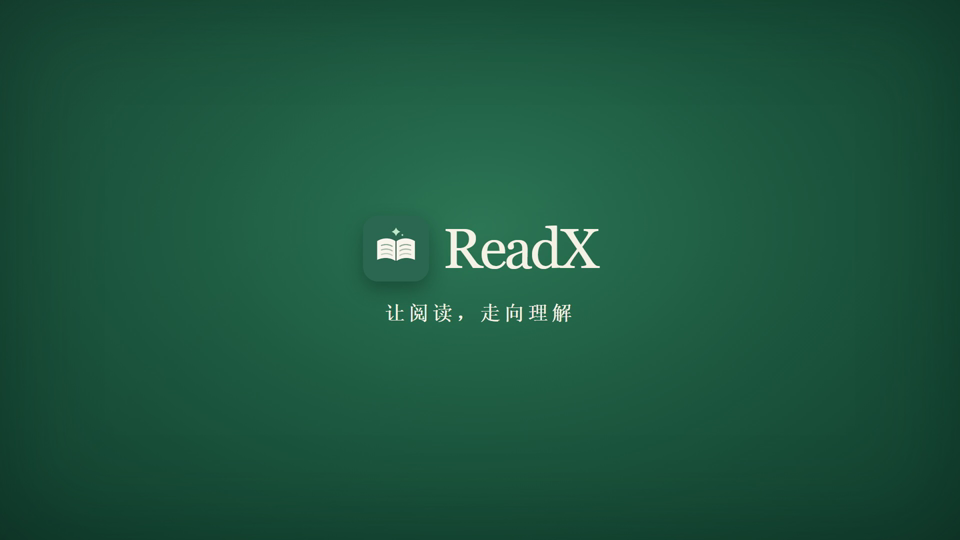

<p align="center">
  
</p>

<h1 align="center">ReadX</h1>
<p align="center"><strong>Research papers, read with context.</strong><br>把论文读懂，也把图表、译文与研究思路连起来。</p>
<p align="center">
  <a href="docs/media/ReadX-宣传片-绿色版.mp4"></a><br>
  <a href="docs/media/ReadX-宣传片-绿色版.mp4">▶ 观看 / 下载 ReadX 产品介绍视频（MP4）</a>
</p>

<p align="center">
  <a href="https://github.com/Leechion/ReadX/releases/latest"></a>
  <a href="https://github.com/Leechion/ReadX/actions/workflows/release-windows.yml"></a>
  <a href="https://github.com/Leechion/ReadX/actions/workflows/build-macos.yml"></a>
  
  
</p>

<p align="center">
  <a href="#中文">简体中文</a> · <a href="#english">English</a> · <a href="windows/README.md">开发与详细使用说明</a>
</p>

<p align="center">
  <a href="https://github.com/Leechion/ReadX/releases/latest"><strong>下载 Windows / macOS 版</strong></a>
</p>

---

<a id="中文"></a>

## 从导入到理解，一处完成

ReadX 是面向科研论文的本地阅读工作区。导入 PDF 后，ReadX 识别页面与段落、翻译并保留原有排版；阅读时可在原文和译文间对照，再用 AI 助教和精读五重奏梳理论文的方法、实验与结果。

<p align="center">
  
</p>

### 主要功能

| 阅读与理解 | 研究与整理 |
| --- | --- |
| **PDF / EPUB 阅读**：目录导航、阅读位置恢复、选区批注；PDF 支持原文、译文和双语对照。 | **精读五重奏**：实验动机、方法公式、实验配置、结果分析、代码复现分别分析、分别保存。 |
| **保留版式的翻译**：识别段落和版面结构，译文按原页位置呈现；可重新翻译书库中的论文。 | **图表融入分析**：识别并裁切论文中的图表，在分析相应章节时把相关图表直接放入正文。 |
| **AI 助教**：围绕当前论文提问；对话按论文保存在本机。 | **模型可选**：配置兼容 API，或连接已登录的 Codex Desktop；可选择可用模型和推理强度。 |
| **译文 PDF**：生成保留原页面布局的译文 PDF，便于阅读与分享。 | **本地优先**：论文文件、阅读进度、批注和精读记录保存在本机。 |

## 精读五重奏

五个部分可以单独生成，并行处理；分析会复用导入时整理的论文上下文。图表与对应章节一起进入分析正文，公式和结果表格保留为可读格式。完成后可导出 Markdown；也可从顶部导航进入独立 PPT 工作区，选择书库论文生成 16:9 演示稿，先通读全文，再按重点解读、对比、方法流程、图文证据、数据聚焦和核心观点六种版式编排。相关原图等比嵌入正文页，预览与导出共用页面布局；宽表和长内容自动分页，完整小节写入讲者备注。中英文使用微软雅黑，数字使用 Times New Roman。

<p align="center">
  
</p>

## 下载与开始

在 [最新 Release](https://github.com/Leechion/ReadX/releases/latest) 下载对应系统的软件包：Windows 下载 `ReadX-Setup-*.exe`，macOS 下载名称中架构与设备相符的 `ReadX-*.dmg`。macOS 首次打开未签名版本时，按系统提示在“隐私与安全性”中确认打开。

首次使用请在 **AI 设置**中配置翻译和问答所用的服务。若使用 Codex Desktop，先在 Codex 中登录，再在 ReadX 的 AI 设置中选择 Codex。不同服务的配置方式见[详细指南](windows/README.md#ai-接入)。

> v0.1.3 首次加入应用内检查更新。已安装 v0.1.2 或更早版本的用户，请先从 Release 页面安装一次 v0.1.3；后续版本可以从应用内检查和安装。

## 更新内容 · v0.1.6

- 新增独立 PPT 工作区，可从书库选择论文，上传并保存自定义模板，查看逐页实时预览；内置主题作为默认样式使用，不出现在模板库列表中。
- 生成前先阅读论文全文并调用本地 `baoyu-slide-deck` skill 规划内容；新增六种学术版式，原图按比例嵌入，宽表与长内容自动分页，来源写入讲者备注。
- 五重奏章节可并行单独生成并复用导入时整理的论文记忆；相关图表直接编入对应章节正文。
- 增强图表识别校验，可在原文页面定位图表区域；修正 PDF 批注高亮、下划线与选区边界。
- 改进阅读器的连续滚动、原文与译文同步定位，以及导入任务状态恢复和后台论文记忆处理。
- 同步 Windows 与 macOS 的功能和界面。

更多细节见 [v0.1.6 Release](https://github.com/Leechion/ReadX/releases/tag/v0.1.6)。

## 数据与隐私

ReadX 的论文、阅读位置、批注和精读内容保存在本机。使用云端模型时，相关论文文本或提问内容会发送给你在 AI 设置中选择的服务；请在使用前查看该服务的隐私政策。API Key 保存在本机配置中，请勿将密钥提交到仓库。

## 开发者

Windows 开发环境需要 Node.js 22.8+ 和 Go 1.27+：

```powershell
cd windows
npm ci
npm run dev
```

生产构建：

```powershell
npm run build
```

macOS 已同步核心源码并提供本机开发及打包入口，见 [`macos/README.md`](macos/README.md)。源码一致性规则见 [`docs/architecture.md`](docs/architecture.md)。

完整的 Windows 功能、AI 接入、数据位置和构建说明见 [`windows/README.md`](windows/README.md)。

## 鸣谢

感谢开源文档处理、OCR、PDF 渲染和论文元数据项目的维护者。第三方组件及许可信息随仓库相应目录提供。

---

<a id="english"></a>

## English

ReadX is a local-first research reading workspace. Import a PDF, read the source alongside its translation, ask an AI tutor questions about the paper, and build a structured understanding with the five-part deep-reading workflow.

### What you can do

- Read PDF and EPUB papers with table-of-contents navigation, saved reading position, and annotations.
- Translate PDFs while preserving page layout, then compare source and translation side by side.
- Ask questions in a paper-specific AI chat and choose from the models available to your configured provider or signed-in Codex Desktop.
- Analyze motivation, methods and equations, experimental setup, results, and reproduction as five independent sections.
- Bring figures and tables into the relevant analysis section, and export translated PDFs or reading notes.
- Keep papers, notes, annotations, and reading progress on your computer.

### Download

Download the Windows installer from [the latest GitHub Release](https://github.com/Leechion/ReadX/releases/latest). Configure an AI provider in **AI Settings** before using translation or AI features. See the [Windows guide](windows/README.md) for setup details.

### Build from source

Requires Node.js 22.8+ and Go 1.27+.

```powershell
cd windows
npm ci
npm run dev
```

---

<p align="center"><sub>ReadX · Research Workspace · Windows and macOS</sub></p>
