<p align="center">
  
</p>

<h1 align="center">ReadX</h1>

<p align="center"><strong>把论文读懂，把研究过程连起来。</strong><br>本地优先的论文阅读、翻译与研究工作区 · Windows / macOS</p>

<p align="center">
  <a href="https://github.com/Leechion/ReadX/releases/latest"></a>
  <a href="https://github.com/Leechion/ReadX/actions/workflows/release-windows.yml"></a>
  <a href="https://github.com/Leechion/ReadX/actions/workflows/build-macos.yml"></a>
</p>

<p align="center"><a href="#中文">简体中文</a> · <a href="#english">English</a> · <a href="windows/README.md">使用与开发文档</a></p>

## ReadX 宣传视频

https://github.com/user-attachments/assets/1b377a2a-c36d-4e51-9923-feb28d1912d2

<p align="center"><a href="docs/media/ReadX.mp4">下载原始高清 MP4</a> · <a href="docs/media/ReadX-宣传片-绿色版.mp4">下载绿色版 MP4</a></p>

## 中文

ReadX 是一个面向科研阅读与论文写作的桌面工作区：导入论文、识别与翻译、逐页双语阅读、高亮批注、AI 精读与学术演示稿生成，都在同一个窗口里完成。LaTeX Studio 支持编辑真实项目文件、编译预览 PDF，并通过带确认卡片的 AI 对话修改源码。论文文件与阅读资料优先保存在本机。

**v1.0.3（Windows）**：新增 AI 服务商预设、文档处理任务重新提交入口，并改进书架展示。完整变更见 [v1.0.3 发布说明](windows/release-notes/v1.0.3.md)。

### 一眼看懂 ReadX

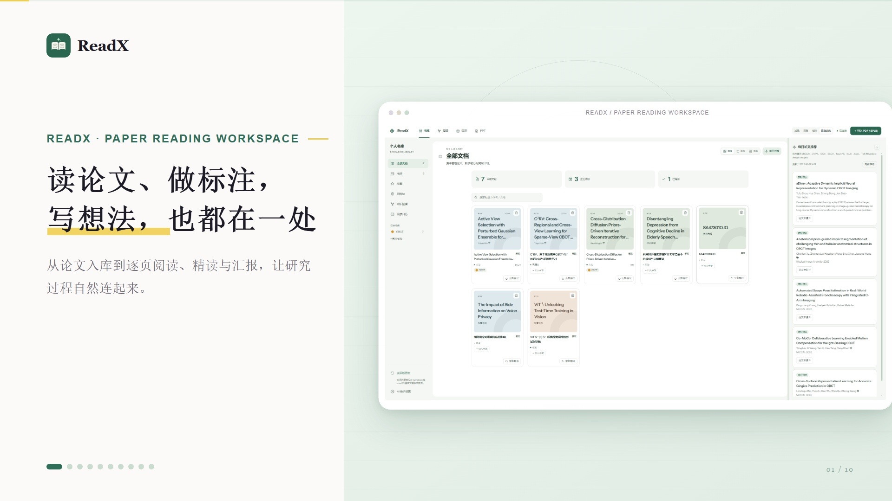

读论文、做标注、写想法，都在一处。从论文入库到逐页阅读、精读与汇报，ReadX 把研究过程的每一步自然连起来：

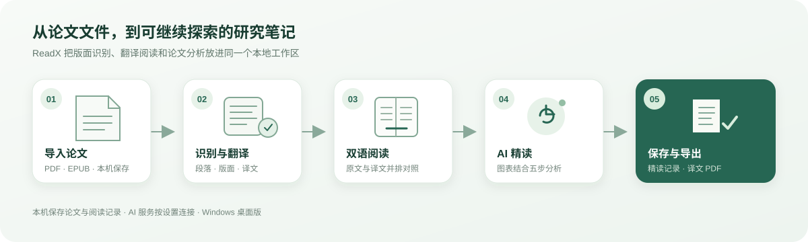

### 功能巡览

#### 01 · 文献库：一个课题一个书库，读到哪儿一目了然

论文集中管理，阅读状态、标签与阅读计划都能随时查看。

- **按课题建库**：左栏提供全部文档、书架、收藏、阅读状态与阅读计划入口，一个课题对应一个书库。
- **卡片式论文列表**：每张卡片显示文件格式、翻译状态、标签与重新翻译入口；顶部统计在库、翻译中与已翻译数量。
- **检索与推荐**：搜索框按标题、作者或标签过滤；右侧「每日论文推荐」汇总 MICCAI、CVPR、ICCV、ECCV、NeurIPS、ICLR、AAAI、TMI 等venue 的新论文。

#### 02 · 导入论文：把论文放进来，阅读从这里开始

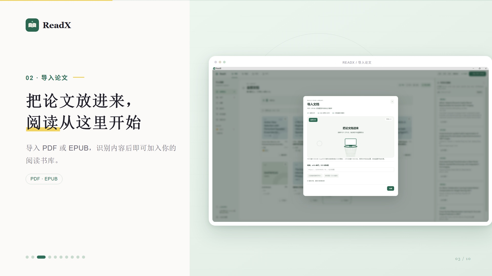

导入 PDF 或 EPUB，识别内容后即可加入你的阅读书库。

- **多种导入方式**：拖拽文件到导入区，或按 arXiv 编号、DOI、URL 直接拉取论文。
- **三步流程透明可见**：选择文件 → 入库并翻译 → 项目目录与译文，导入前即告知限制（PDF 最大 512 MB，扫描版需 OCR；EPUB 最大 100 MB）。
- **本机保存**：论文入库后保存在本机，并自动进入翻译处理队列。

#### 03 · 处理进度：每一步处理进度，都清楚看得见

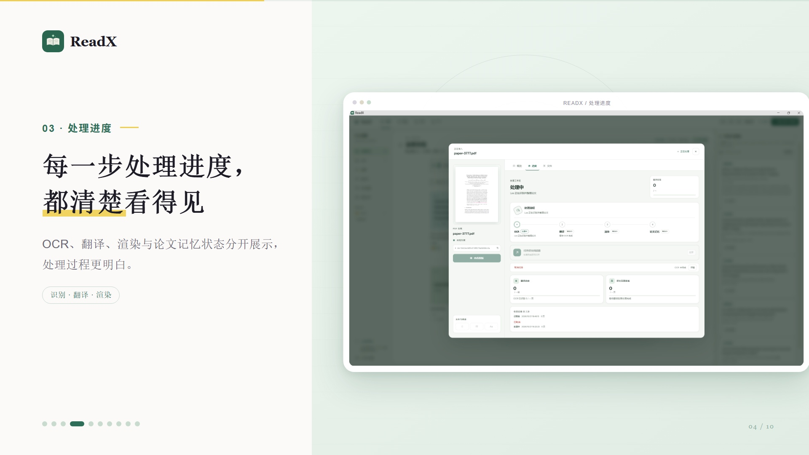

OCR、翻译、渲染与论文记忆状态分开展示，处理过程更明白。

- **四段流水线**：OCR → 翻译 → 渲染 → 论文记忆依次执行，每一步显示「处理中 / 等待中」状态。
- **按页计数**：翻译进度与渲染进度以页为单位实时累计，有效结果日志记录每步的开始与完成时间。
- **多视角查看**：概览、进度、文件三个页签切换，处理可随时取消或重试。
- **中断后一键重新处理**：应用重启、失败或取消把任务停在中途时，处理面板的对应行与任务详情里都有「重新处理」按钮——点一下就重新提交，有可复用的识别结果就接着翻，没有就把原因原样告诉你（需要先重新识别时会说清缺什么）。不用再回书库找那篇论文的「重新翻译」。
- **重新翻译不必重新导入**：书库里的「重新翻译」优先复用已有的识别结果，只重跑翻译；如果这篇论文没有可复用的识别结果（旧版本导入、识别产物已被清理），它会**自己重新识别再翻译**，并把更新后的逐页文本与版式写回书库。前提（模型与 PaddleOCR 令牌）缺失时会立刻说清缺什么，而不是让人重新导入——那会丢掉批注、精读笔记与阅读进度。

#### 04 · 双语阅读：原文译文并排，逐页对照着读

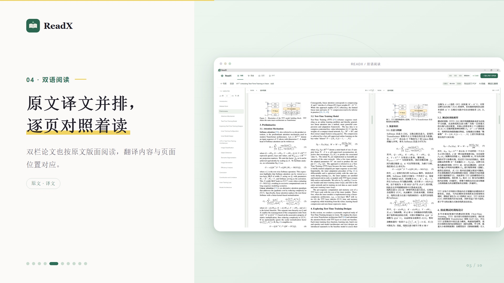

双栏论文也按原文版面阅读，翻译内容与页面位置对应。

- **并排对照**：原文页与译文页左右并排、逐页同步翻页（上一页 / 下一页），保留双栏版面、公式与图表位置。
- **章节直达**：左栏章节目录（Introduction、Related Work、Preliminaries…）点击即跳转对应页面。
- **三种视图**：顶栏可在双语、仅原文、仅译文之间切换，并可导出带批注的 PDF。

#### 05 · 高亮与批注：选中一段或一个公式，标注后就能继续问

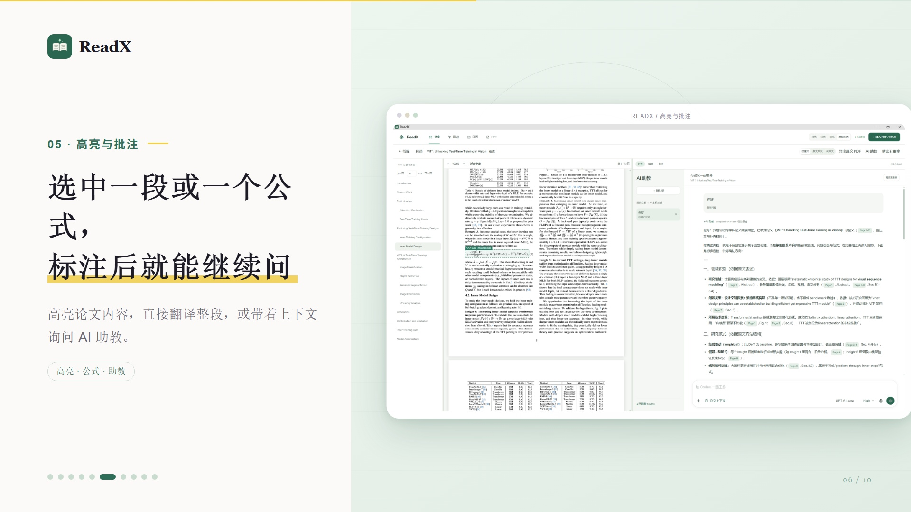

高亮论文内容，直接翻译整段，或带着上下文询问 AI 助教。

- **选中即标注**：框选段落或公式即可高亮，重点内容随论文保存。
- **标注即入口**：选中文本可整段翻译，或一键送入右侧 AI 助教面板继续追问。
- **批注可回溯**：高亮与批注跟论文一起留在本机，下次打开仍在原页原位置。

#### 06 · AI 助教：围绕论文上下文，继续问到真正弄懂

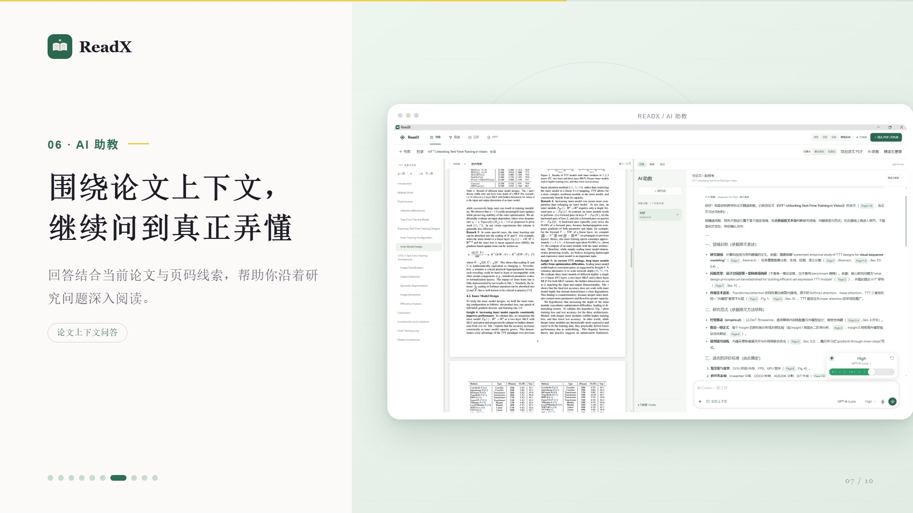

回答结合当前论文与页码线索，帮助你沿着研究问题深入阅读。

- **论文上下文问答**：提问默认附带当前论文内容，回答自动标注出处（Page 1-3、Fig. 1、Sec. 5 等），可点击回原文核对。
- **顺着线索追问**：从一段解释追到具体页、具体公式，直到真正弄懂为止。
- **强度可调**：模型与推理强度（如 High）随时切换，快查与深读各得其所。

#### 07 · 精读五重奏：把精读拆成五步，逐项梳理研究脉络

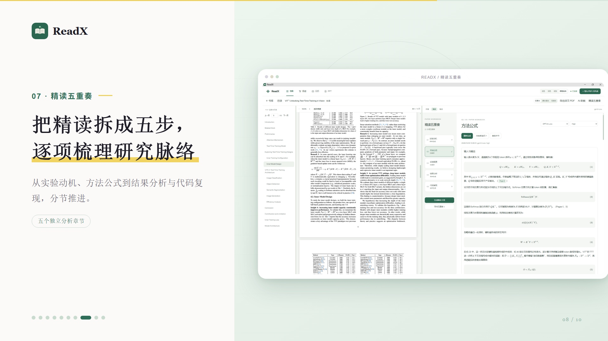

从实验动机、方法公式到结果分析与代码复现，分节推进。

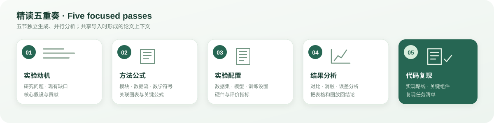

- **五个独立章节**：实验动机、方法公式、实验配置、结果分析、代码复现，各自独立生成、独立保存、可单独重新生成。
- **带出处的分析**：每节内容附页码与公式引用（如 Page 1、Page 3），结论可逐条回原文核对。
- **可导出积累**：完成的章节可导出，逐步沉淀成该课题的结构化精读笔记。

#### 08 · 论文演示稿：从论文到汇报，边生成边预览

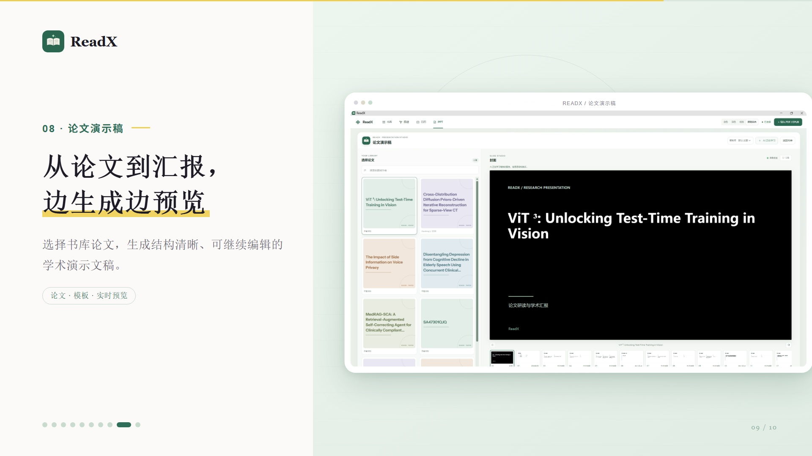

选择书库论文，生成结构清晰、可继续编辑的学术演示文稿。

- **从书库直达汇报**：在演示稿工作区左侧挑选论文，一键生成整套学术 PPT。
- **边生成边预览**：右侧实时预览当前幻灯片，底部缩略图条显示全部页（如 1 / 12）与生成进度。
- **模板可换**：内置主题与自定义模板可选，生成的幻灯片可继续编辑后用于组会或汇报。

#### 09 · AI 助手设置：连接你常用的模型，按自己的方式阅读

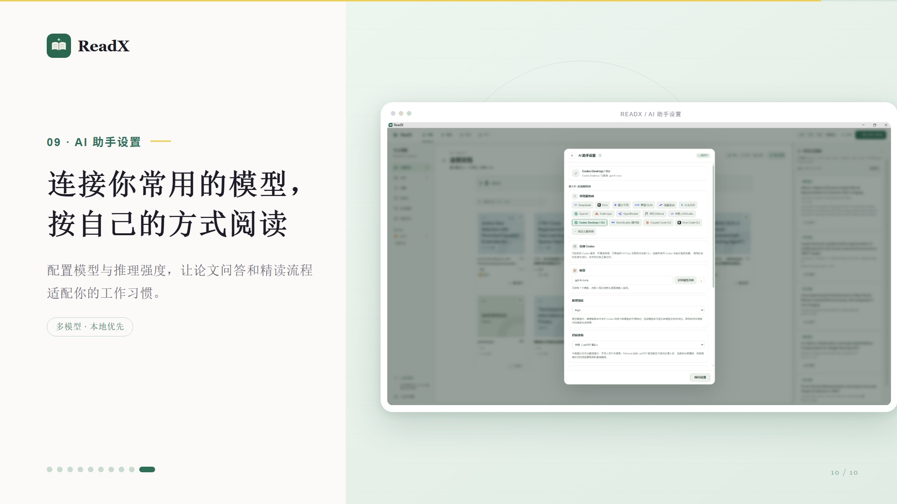

配置模型与推理强度，让论文问答和精读流程适配你的工作习惯。

- **多模型预设**：内置 DeepSeek、OpenAI、Anthropic、OpenRouter、通义千问、智谱 GLM、月之暗面、火山引擎等常用服务商，也支持自定义服务端点。
- **CLI 直连**：Codex Desktop / CLI、Claude Code CLI、Kimi Code CLI 等可直接连接；Codex Desktop 用户登录后即可使用，无需单独管理密钥。
- **按流程配置**：模型、推理强度等设置保存在本机，翻译、问答与精读可各用各的组合。

#### 10 · 查找、检索与对照：把散在各篇里的东西找出来

论文多了以后，真正的成本是「我记得在哪见过」。这一组能力都围绕「找到并回到原文」：

- **文档内查找**：阅读器按 Ctrl/Cmd+F 打开查找条，命中计数、上下条跳转，命中处直接在页面上标出（仅译文模式查译文，其余查原文）。
- **全库全文检索**：书库搜索框可切到「全文」，在已索引的逐页正文里检索，结果显示论文、页码与上下文片段，点一下跳到那一页并自动定位到命中处。结果头部会说明索引覆盖（未翻译且没在阅读器里打开过的论文、整页扫描的论文不在索引内）。
- **跨文献对照**：从「对照」工作区选 2–4 篇，把「精读 · 实验配置」的七个维度（研究对象与数据、研究设计与条件、实施流程、分析方法、对照或基线、评价标准、结果）并排摊开，每格都带页码可回原文；还没抽取的论文可以就地生成。表里区分「未抽取」与「论文未提及」两种状态。

#### 11 · 引用与统计：把阅读沉淀成可用的材料

- **书目导出**：阅读器工具栏「引用」或书库「导出书目」，导出 BibTeX / RIS（单篇、按书架或整库）。下载前会先告诉你条目类型是怎么判定的：按会场名识别会议/期刊，判断不出来时用 `@misc` 并原样带出会场名，不替作者猜；作者姓名按题录原样输出。
- **引用关系**：阅读器工具栏「引用网络」看这篇论文与本库其它论文的引用关系（哪几篇是它的参考文献、本库哪几篇引用了它），数据来自 OpenAlex，结果缓存 7 天。只有题录里有 DOI 的论文可查，这一点会在界面上写明。
- **书库统计**：阅读日历页底部给出在库/在读/已精读、最近 7 天与 30 天在读篇数、批注与精读产出、各处理阶段（OCR / 翻译 / 渲染）的耗时中位数与每页耗时，以及年份、书架与主题分布。不报「读了多久」——页面停留时长没有采集，不编。

#### 12 · 知识图谱：跨文献的概念连成一团可旋转的点云


把每篇论文抽出的实体与关系合并成一张跨文献图谱，用**双环同心点云**呈现：

- **越靠圆心＝被越多篇论文共享**：核心环是被多篇共享的实体（真正沉淀下来的共识），外圈是只出现在一篇里的实体，最外层是论文本身——每篇论文连到它包含的实体。
- **每个点都能点开**：拖拽旋转、滚轮缩放、右键平移，可开自转；悬停一个点会点亮它的全部连线并放大邻居；点标签或点，右侧面板列出关系与**逐字、带页码的原文依据**，点依据回到阅读器对应页。搜索与类型筛选会就地重新收敛。
- **如实披露**：状态行给出跨文献实体数与关系边数；关系来自 AI 抽取、按论文逐篇进行，没抽取过的论文不在图里；点或边超过绘制上限时会说明只画了前多少条。
- **对照表视图保留**：图形负责「看形状」，矩阵负责「读交集」（共有 / 仅各篇逐条列清楚），两种问题分别回答。
- **实现说明**：点云用 three.js（WebGL）渲染，按主题切换混合模式（深色底走加色发光，浅色与纸张底走常规混合），并且随图谱工作区懒加载——不打开图谱就不会下载这部分代码。

#### 13 · LaTeX Studio：在本机写论文并当场看到排版结果

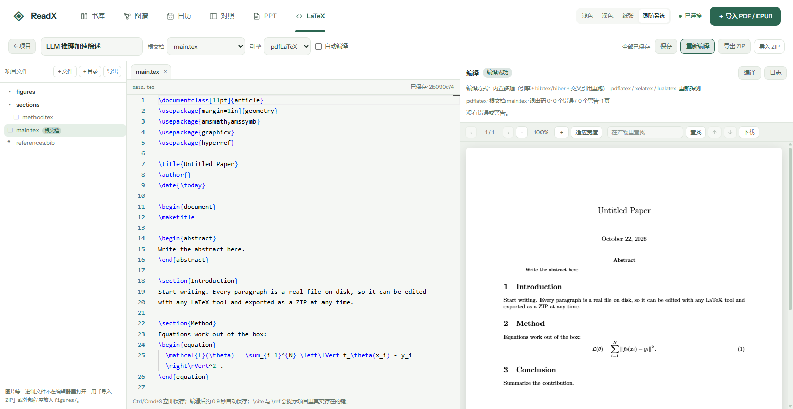

一个与书库并列的独立工作区，功能是「写 LaTeX 并编译」这件事本身，读写的是磁盘上真实的 `.tex` 文件：

- **项目与文件**：新建项目会得到一份可直接编译的模板（`main.tex` / `references.bib` / `sections/` / `figures/`）；也可以把 Overleaf 导出的 ZIP 直接导进来（自动剥掉外层目录、跳过系统垃圾与编译副产物，并在报告里列出跳过了什么），或随时把源码导出成 ZIP（导出前剔除 `.aux`/`.log` 等副产物）。
- **编辑**：编辑器是 Monaco（按需加载，不打开这个工作区就不会下载），带 LaTeX 语法高亮、`\begin`/`\end` 配对折叠、Ctrl/Cmd+S 立即保存与约 0.9 秒防抖的自动保存。`\cite` 与 `\ref` 的候选来自项目里真实的 `.bib` 条目与 `\label`；引用了不存在的键会直接标波浪线——那正是编译必然报 undefined 的地方。
- **编译**：用**本机安装的 TeX 发行版**编译（MiKTeX / TeX Live），latexmk 可用时优先用它，不可用时走内置多趟（引擎 → 需要时跑 bibtex/biber → 交叉引用重跑，最多六趟）。工具链状态如实报告：哪个引擎可用、哪个不可用、为什么不可用（例如本机 `latexmk.exe` 在、但缺 Perl 跑不起来，界面就会这么写，并说明已改用内置多趟）。
- **毫秒级实时预览**：选择 LuaLaTeX 并开启实时预览后，使用 rtex 按段落增量排版；首次预览排版整篇文档，之后编辑时只更新受影响的段落，并显示段落排版耗时。需要本机 LuaLaTeX；首次使用时可从界面下载并安装 rtex 实时排版引擎。普通 PDF 编译预览仍可用于查看完整编译结果。
- **诊断**：编译错误与警告按「文件:行号 + 出错的那行源码」列出来，**点一下就跳到编辑器对应位置**；页数、退出码、错误/警告数一并显示，完整日志可随时打开。产物对应的是哪一版源码也被记住，改完源码还没重编译时会明确提示「当前 PDF 是上一次的产物」。
- **预览**：右栏用 PDF.js 显示编译产物，支持翻页、缩放、适应宽度、下载，以及**在产物里查找**（扫描进度与「有页面读不出文字」都会如实说明）。
- **直接在对话里请求修改**：输入「把 abstract 中的数字删掉」或「润色这一段，保留 LaTeX 命令」并发送，AI 会在对应回复下生成**修改确认卡片**，列出目标文件和修改说明，可展开查看修改前后内容。点**「确认修改」**后才创建源码快照并保存；点「取消修改」则保留原文件。输入栏的**「请求批准」**说明这一确认方式，不需要再找单独的预览按钮。每张卡片对应一个项目内的 `.tex` 或 `.bib` 文件。
- **结合项目源码定位内容**：助手会读取当前编辑内容和项目内的 `.tex` / `.bib` 上下文，可沿着 `main.tex` 中的 `\input`、`\include` 找到实际章节。例如当前打开 `main.tex`，也可以请求修改 `sec/0_abstract.tex`。大型项目受上下文长度限制；保存前会再次核对源码，避免覆盖 AI 生成期间的新改动。
- **自动修复编译错误**：展开**「编译修复与源码快照」**可生成修复建议、查看快照或执行自动修复。在工具栏开启**「自动修复写入」**后，自动修复会按「快照 → 写入 → 真实编译 → 错误未减少则回滚」执行，并显示错误数变化和保留／回滚结果；聊天中的修改仍然逐次请求确认。手动回滚会把项目恢复到快照时刻，之后新增的文件会被移除并列出。
- **按自己的习惯安排界面**：项目目录可以拖宽，目录字号更大；编译诊断列表可以隐藏，无错误和警告时不再显示空提示；编译修复与源码快照默认折叠，让对话和 PDF 预览有更多空间。
- **LaTeX 可以单独指定模型**：AI 助手面板里的**「模型设置」**可配置 HTTP 提供方、API 地址、模型与推理强度；模型列表支持拉取和搜索选择，保存后助手标题与输入栏同步显示配置。默认跟随全局，也可以为 LaTeX 单独配置，**不影响阅读与翻译用的全局渠道**。密钥按「渠道 + 地址」隔离保存；单独配置支持 HTTP 渠道，CLI 渠道的可用性取决于后台运行环境。
- **本机编译与 AI 上下文**：编辑、TeX 编译和 PDF 预览在本机完成；使用 AI 问答或修改时，相关项目源码会发送给所选模型服务。编译修复日志在服务端脱敏后发送，操作系统用户名、家目录和项目绝对路径会被替换。

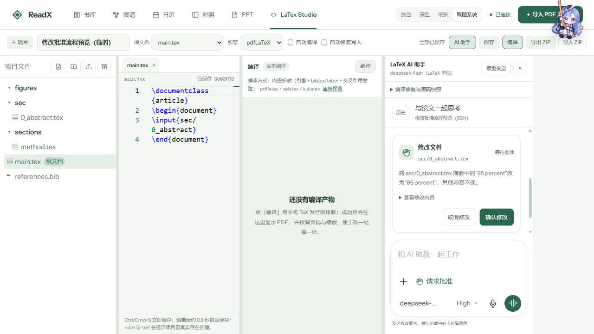

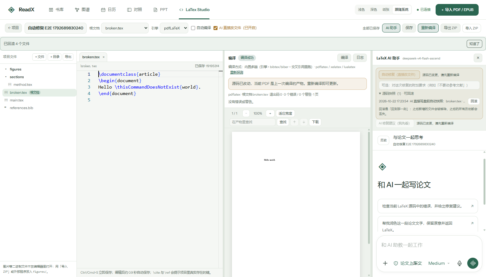

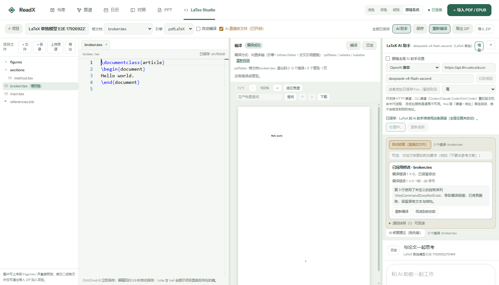

- **诊断说真话**：每条诊断都标明**是谁报的**（LaTeX / Package natbib / Class IEEEtran…），位置要么来自日志行，要么来自在项目里找到这个引用键（`\cite`/`\ref` 的那个键写在哪一行是确定的事实）；日志没说位置的整篇级警告就显示「日志未给出位置」，**不猜一个文件行号给你**——指错地方比不给地方更浪费时间。诊断列表与「N 个警告」这个数字同源，不会出现「说有 28 条却只列一条」。
- **编译来的行号是对的**：新一次编译会沿用上一次的辅助文件（`.aux`/`.bbl`/`.toc`…，但绝不搬上一次的 PDF 或日志），多趟按 TeX 自己的提示跑到收敛（上限 6 趟，实测一份真实 CVPR 评审模板要 5 趟）。所以评审模式（`[review]{cvpr}` + lineno）的**页边行号能算准**，不会再停在一句「re-run to get it right」上。

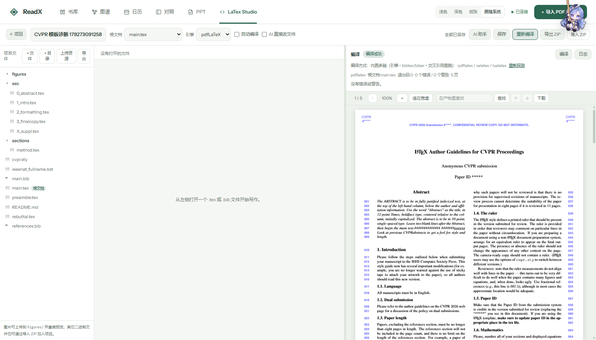

- **隔离与安全**：项目源码放在独立目录，不改动书库的任何记录，也不影响阅读、OCR、翻译、演示稿的语义。文件路径一律按「项目内相对路径」校验：`..`、绝对路径、盘符、符号链接、Windows 保留设备名都会被拒绝；写入是原子的，并且带内容指纹校验——文件被外部程序改过时不会静默覆盖，而是让你选「重新加载」还是「以我的版本覆盖」。编译调用的可执行文件来自白名单，项目里的字符串永远不会被当作命令执行。

#### 14 · 摸鱼界面：挂件拉幕切换，本地小说与漫画随手读

<p align="center">
  
  
</p>

左图为窗帘转场中的截图，右图为切换后的本地书架。点击顶部挂件，合幕遮住当前页面，再揭幕进入另一个工作区；两个方向都使用这段动画。

- **点击挂件切换**：科研与摸鱼界面之间以**淡绿色漫画窗帘**合拢、再展开，使用平涂色块、描边褶皱、扇形帘头和少量网点。按住挂件可沿窗口顶部拖动，位置会记住。也可按 `Ctrl+Shift+M` 切换，在摸鱼界面按 `Esc` 返回科研工作区。
- **本地书架**：导入 TXT、EPUB、图片或 CBZ，在独立书架中阅读小说与漫画，阅读内容和进度保存在本机浏览器。
- **摸鱼周报与小游戏**：书架顶部汇总本周摸鱼时长、读完的章节/页数与连续天数；「小游戏」内置 2048（方向键 / WASD / 滑动游玩，进度与最佳分自动保存，Esc 先回书架再退出摸鱼）。
- **下班倒计时挂件**：摸鱼界面顶部悬挂的小牌显示距下班、距周末、距元旦，沿窗口顶部拖动、点开可改下班时间或收起，收起后可在书架工具栏找回。
- **找书并直接阅读**：统一书源入口支持 Project Gutenberg、Gutenberg 官方 OPDS、Z-Library 非官方 EAPI 及原有中文连载（本地文件导入统一在书架进行）。查看书籍详情、格式和来源权利后，可下载 EPUB / TXT，查看进度、取消或失败重试；校验成功自动加入本地书架并打开阅读器，相同文件保留原进度。Z-Library 可配置服务地址，连接自己的账号或会话；逐书确认权限并通过账号的文件权限检查后下载，会话仅保留到本次服务退出。中文连载继续支持兼容的 Legado 书源 JSON。在线操作需要网络、可用书源及相应账号权限；[书源范围、接口与验证说明](docs/book-sources.md)。

##### 挂件来源与致谢

- **借鉴的项目**：顶部悬挂角色、以拉绳作为入口的设计借鉴了 [elysia395/dsh-wallpaper-engine](https://github.com/elysia395/dsh-wallpaper-engine)（DSH Wallpaper Engine，npm 包名 `dsh-plugin-wallpaper-engine`）。感谢原项目作者与贡献者。
- **图片来源**：当前 Qwen 挂件取自本机已安装的上述插件中的 `ROPE_IMG_QWEN` 图片，保存为 `windows/apps/web/public/slack/qwen.png`（macOS 使用同一素材）。
- **角色创作致谢**：按[上游素材说明](https://github.com/elysia395/dsh-wallpaper-engine/blob/main/assets/readme/SOURCES.md)，AI 娘二创形象的创作基础来自 B 站 UP 主 [ZipZipPipe](https://space.bilibili.com/4168597)。角色与图片权利归各自权利人，ReadX 的 MIT 代码许可不改变这些素材的权利归属。
- **ReadX 的适配**：科研 / 摸鱼双界面切换、挂件沿顶部拖动与位置保存，以及淡绿色漫画 SVG 窗帘和合幕换景动画，由 ReadX 实现。

### 下载与开始使用

从[最新 Release](https://github.com/Leechion/ReadX/releases/latest)下载 Windows 或 macOS 安装包。启动后，在 **AI 助手设置**中选择模型服务并配置连接；Codex Desktop 用户可先登录 Codex，再从 ReadX 中连接。

v1.0.3 提供 [Windows x64 安装包 ReadX-Setup-1.0.3.exe](https://github.com/Leechion/ReadX/releases/download/v1.0.3/ReadX-Setup-1.0.3.exe)。Release 中的 `.blockmap` 和 `latest.yml` 用于应用内自动更新，手动安装只需下载 `.exe`。

#### macOS 首次启动

将 `ReadX.app` 拖到“应用程序”文件夹后，如果 macOS 拦截首次启动，在“终端”中依次执行：

```sh
sudo spctl --master-disable
xattr -cr /Applications/ReadX.app
```

第一条命令会全局关闭 Gatekeeper，降低 macOS 对应用的安全检查。请只对从可信来源下载并确认过的 ReadX 安装包执行；首次打开后，可用 `sudo spctl --master-enable` 重新启用 Gatekeeper。`sudo` 提示输入密码时，终端不会显示输入内容。

详细的安装、AI 配置、数据存放位置和故障排查说明见 [Windows 使用文档](windows/README.md)；macOS 构建说明见 [macOS 文档](macos/README.md)。

### 隐私说明

ReadX 将论文及阅读资料保存在本机。使用 AI 翻译、问答或 LaTeX 源码修改时，相关文本、图片或项目源码会发送给你选择的模型服务。API 密钥保存在本机配置中，请勿提交到仓库。

## English

ReadX is a desktop workspace for research reading. Import papers, let recognition and translation run on your machine, then read bilingually page by page, highlight and annotate, ask a paper-aware AI assistant, split deep reading into five focused passes, turn the results into an academic presentation, and write your own LaTeX papers against the TeX distribution already installed on your machine. Papers and reading data stay on your computer by default. The numbered items below match the screenshots in the Chinese tour above.

### Features

1. **Library (01)** — One library per project with shelves, favorites, reading status, reading plans, card-style paper list, and a daily paper recommendation panel.
2. **Import (02)** — Drag in PDF / EPUB or fetch by arXiv ID, DOI, or URL; a three-step dialog shows limits and what happens next.
3. **Processing (03)** — A visible OCR → translation → rendering → paper-memory pipeline with per-step status, page-level progress, and a result log. "Re-translate" in the library reuses the stored OCR result when there is one and **re-runs OCR itself when there is not**, writing the refreshed page text and layout back to the library — it never sends you off to re-import, which would cost your annotations, notes, and reading progress.
4. **Bilingual reading (04)** — Original and translated pages side by side with synced paging, section navigation, preserved two-column layout, and annotated-PDF export.
5. **Highlights & notes (05)** — Highlight passages and equations, translate a whole paragraph, or send the selection to the assistant with context; annotations persist locally.
6. **AI assistant (06)** — Paper-context Q&A whose answers cite pages, figures, and sections so every claim can be checked against the source.
7. **Deep-reading quintet (07)** — Five independently generated and saved sections: motivation, methods and equations, experimental setup, results analysis, and code reproduction.
8. **Presentation studio (08)** — Pick a paper from the library and generate an editable academic slide deck with live preview, thumbnails, and built-in or custom templates.
9. **AI settings (09)** — Presets for major providers plus custom endpoints and CLI connections (Codex, Claude Code, Kimi Code), with per-flow model and reasoning-effort choices.
10. **Find, search & compare (10)** — In-document find with hit counts and next/previous (Ctrl/Cmd+F); library-wide full-text search over indexed page text with snippets, coverage disclosure, and jump-to-page; a cross-paper comparison table for 2–4 papers built from their experimental-setup extractions, with per-cell page links and an explicit "not extracted" vs "not reported" distinction.
11. **Citations & stats (11)** — BibTeX / RIS export (single paper, shelf, or whole library) that discloses how each entry type was inferred; an OpenAlex-backed citation network showing which library papers this one cites and which cite it; and library statistics covering reading activity, annotations, per-stage processing durations, and year/shelf/topic distribution. Stay time is deliberately not reported — it is not collected.
12. **Knowledge graph (12)** — cross-paper entities and relations rendered as a dual-ring point cloud: shared entities sit nearest the center, single-paper entities around them, papers on the outer shell, all interlinked. Drag to rotate, scroll to zoom, hover a node to light up every link, click for relations with verbatim, page-anchored evidence that jumps back to the source page. A matrix view stays available for reading exact overlaps. Rendered with three.js (WebGL), lazy-loaded with the graph workspace.
13. **LaTeX Studio (13)** — Create a starter project or import an Overleaf ZIP, edit real `.tex` / `.bib` files with Monaco, and preview PDFs compiled by your local TeX distribution. With LuaLaTeX and the rtex engine, live preview incrementally typesets changed paragraphs and reports their layout time; the first preview typesets the full document. Send an edit request in chat: the assistant uses project source context to locate the file and returns an approval card with a before/after preview. **Confirm modification** creates a snapshot and saves through the revision-checked file path; **Cancel modification** leaves the file as it was. Each card edits one project source file. LaTeX can use its own HTTP model settings, including a searchable model list. The file tree is resizable, diagnostics can be hidden, and compilation tools and snapshots are collapsed by default. The separate automatic compile-repair action requires its own write toggle and rolls back edits that do not reduce compile errors.
14. **Leisure workspace (14)** — Click the draggable top pendant to switch between research and leisure with pale-green comic curtains: flat colors, outlined folds, scalloped valances, and subtle halftone dots. Read local TXT / EPUB novels and image / CBZ comics, search Project Gutenberg and import downloads into the local shelf, or add compatible Legado sources for serialized novels. A weekly slacking report sums reading time, chapters, pages, and streak days; the "mini game" tab ships a 2048 with saved progress and best score; a draggable off-work countdown sign hangs at the top. `Ctrl+Shift+M` switches modes; `Esc` returns from leisure to research.

**Pendant credits:** The hanging rope mascot design is inspired by [elysia395/dsh-wallpaper-engine](https://github.com/elysia395/dsh-wallpaper-engine); the Qwen image is taken from its `ROPE_IMG_QWEN` asset. [Upstream credits](https://github.com/elysia395/dsh-wallpaper-engine/blob/main/assets/readme/SOURCES.md) acknowledge [ZipZipPipe](https://space.bilibili.com/4168597) for the AI-girl character designs. Character and image rights remain with their respective owners. ReadX implements the workspace switch, pendant positioning, and pale-green comic curtain transition. See the [screenshots and Chinese credits above](#挂件来源与致谢).

### Download

Download the latest Windows or macOS installer from [GitHub Releases](https://github.com/Leechion/ReadX/releases/latest). Configure an AI provider in **AI Assistant Settings** before using translation or AI features. See the [Windows guide](windows/README.md) for setup details.

### Privacy

Papers, annotations, reading progress, and notes are stored locally. When you use AI translation, Q&A, or LaTeX editing, relevant text, images, or project source context is sent to your selected model service. API keys stay in local configuration — never commit them.

### Build from source

Windows development requires Node.js 22.8+ and Go 1.27+:

```powershell
cd windows
npm ci
npm run dev
```

For macOS development and packaging, see [`macos/README.md`](macos/README.md).

### License

ReadX is released under the [MIT License](LICENSE). Third-party components retain their respective licenses.

---

<p align="center"><sub>ReadX · Research Reading Workspace · Windows and macOS</sub></p>
